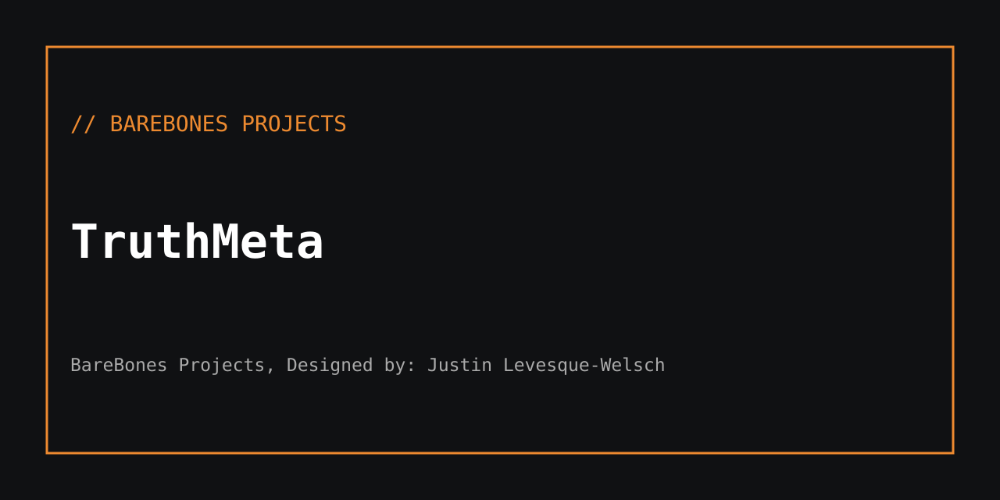

# // TruthMeta · Bones & Remedy

**Version:** 0.10.0-alpha (Chrome extension + loopback SQLite portal)  
**Release status:** Security hardening in review. **Not approved for public hosting.**

TruthMeta is a human-reviewed evidence capture and case tracking prototype. The extension provides a deliberate page-capture workflow. The local portal handles case, evidence, user and audit records. **An automatic claim-verification or immutable forensic chain is not established by the current source.** Evidence and findings require human review.

## Requirements and first run

- Node.js 22 or newer (the portal uses Node's `node:sqlite` module).
- Chromium-based browser with extensions enabled.
- Local loopback access. Do not bind the portal to an external interface before a security review.

```sh
cp .env.example .env
# Edit .env: supply a UNIQUE METATRUTH_ADMIN_PASSWORD, 16+ characters.
node --env-file=.env portal/server.mjs
```

Open http://127.0.0.1:8787 and sign in using the configured admin email/password. The portal will **refuse first-run account initialization** if the password is absent or shorter than 16 characters. Existing local users remain in your local database.

## Extension setup

1. Open Chrome/Chromium > Extensions > Developer mode > Load unpacked.
2. Select the tracked `extension/` directory.
3. Find the installed extension ID in the extensions page.
4. Set `METATRUTH_ALLOWED_ORIGINS=chrome-extension://<your-extension-id>` in the server environment, then restart the portal.
5. Configure the portal URL `http://127.0.0.1:8787` in the extension. Use the in-app capture and review workflow with non-sensitive test data first.

By default, API cross-origin requests are rejected unless their **exact origin** is configured. Wildcard CORS is forbidden. Loading local HTML in a browser does not authorize every origin to access the portal.

## Architecture

| Path | Purpose |
|---|---|
| `extension/manifest.json` | Chromium Manifest V3 and requested permissions |
| `extension/service-worker.js` | Extension background actions |
| `extension/portal-api.js` | Portal client transport |
| `portal/server.mjs` | Local HTTP API, session checks and static portal assets |
| `portal/db.mjs` | SQLite schema and WAL-mode local persistence |
| `test_release.py` | Manifest and static extension checks |
| `portal/security.test.mjs` | Origin, login and authorization smoke tests |

## Development checks

```sh
python3 test_release.py
node --check portal/server.mjs
node --test portal/security.test.mjs
```

See [security remediation](docs/SECURITY_REMEDIATION_2026_11_13.md). SQLite files under `portal/data/` are **runtime state**, not source. Journal files previously committed have been removed on a review branch, but historical Git objects require a separate data-exposure assessment.

## Known security and functional limitations

- Server-side authorization requires a complete audit on every route; the included tests cover representative login/origin paths, not a comprehensive penetration test.
- Authentication uses a prototype password-hash function and should migrate to unique per-user salts with a modern password KDF.
- CORS checks reduce browser access but do **not** replace tokens, CSRF defenses, request throttling, database backups or operating-system permissions.
- The audit hash chain is application-controlled and not an independently immutable ledger.
- The extension currently requests broad URL access. Review and minimize it before distribution.
- No production-hosting, backup/restore, incident response or public deployment certification has been completed.

## Alpha release gate

- [ ] All CI checks pass and installation tests cover the target Chromium version.
- [ ] Server-side RBAC, input-validation, timeout, rate-limiting and audit integrity tests pass.
- [ ] User data, database histories and packaged artifacts contain no private test records.
- [ ] Extension permissions and provenance workflows reviewed.
- [ ] Signed or checksummed release archive, documented rollback and human review completed.

Do not promote this application beyond a **local test alpha** until these gates are satisfied.

---

BareBones Projects, Designed by: Justin Levesque-Welsch
